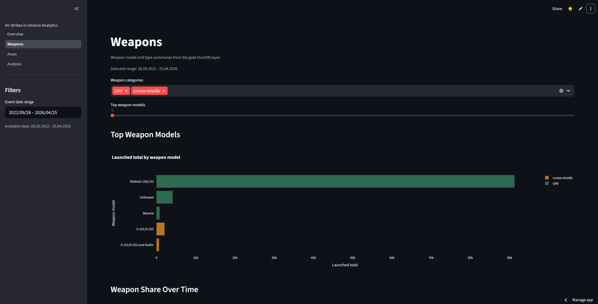
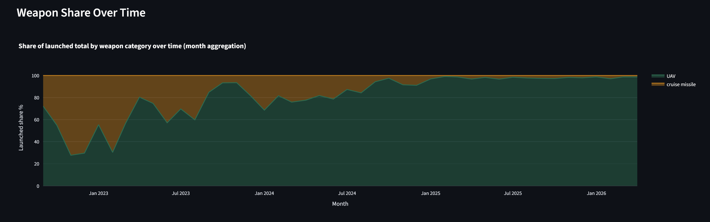
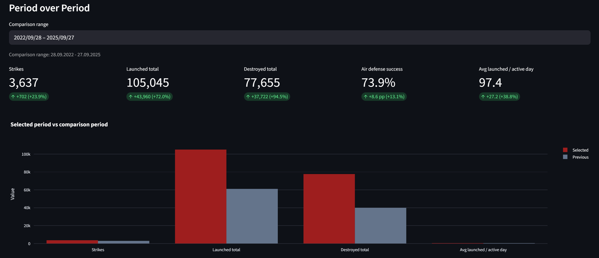

## Portfolio

A selection of my work in data engineering, analytics, and machine learning.

---

### Experience

### Cense Analytics - Machine Learning & Data Science Intern

Worked on building and maintaining data pipelines and machine learning solutions in a Databricks environment using Python, SQL, and Apache Spark. Focused on data quality and reliability by identifying inconsistencies, tracing root causes, and improving data structures for downstream use. Built image-based machine learning solutions end-to-end, including data preprocessing, feature engineering, model development, and validation, achieving strong results (details confidential).

---

### Projects

#### Air Strikes on Ukraine Analysis Dashboard

In this MVP-stage project, I developed an end-to-end data analytics solution for exploring reported missile and UAV strike activity in Ukraine. The project combines data analysis, data engineering, and dashboard development: I collected and processed raw CSV data in Python with pandas, cleaned and standardized key fields such as dates, weapon references, and target areas, and transformed the data into a bronze, silver, and gold architecture. I then used DuckDB and SQL to build analytics-ready marts and views, and created an interactive Streamlit dashboard with Plotly and PyDeck to visualize trends over time, weapon activity, regional patterns, and air defense success rates.

  

    
    
Dashboard overview

  

  

    
    
Interactive map and regional analysis

  

  

    
    
Weapon activity analysis

  

  

    
    
Weapon share comparison

  

  
  
Period-over-period comparison

#### Korisliiga Winners App

This is a small web application for browsing Korisliiga championship winners. I included it as a lightweight side project alongside my main data and analytics work.

---

Page template forked from <a href="https://github.com/evanca/quick-portfolio">evanca</a>

