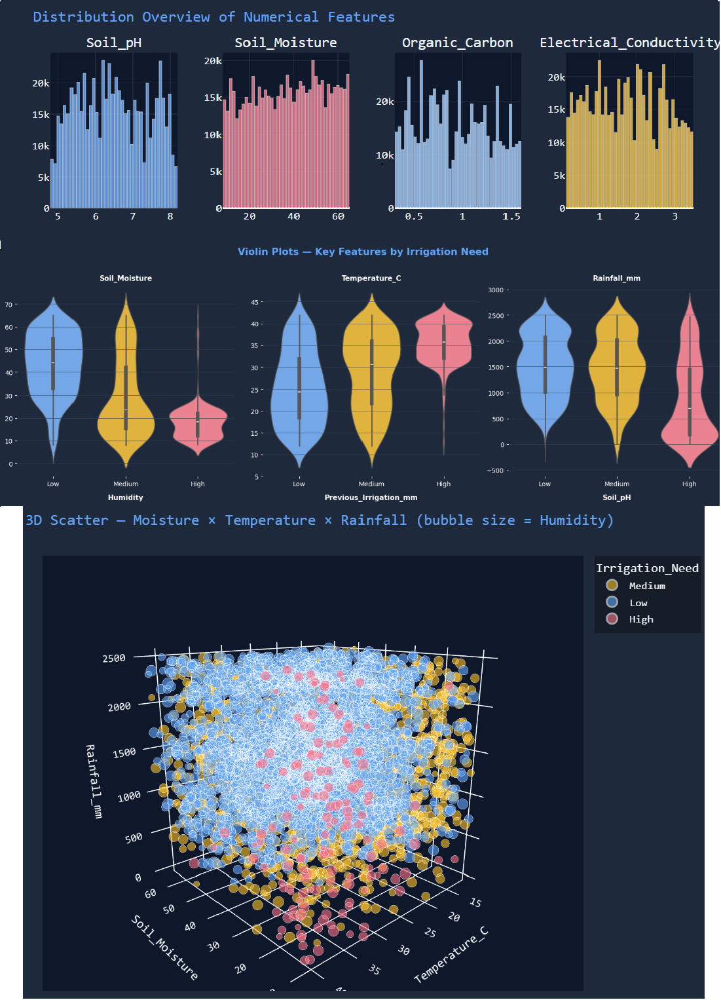

## Portfolio

A selection of my work in data engineering, analytics, machine learning and AI agent engineering.

---

### Experience

### Cense Analytics - Junior Data Scientist

Worked on building and maintaining data pipelines and machine learning solutions in a Databricks environment using Python, SQL, and Apache Spark. Focused on data quality and reliability by identifying inconsistencies, tracing root causes, and improving data structures for downstream use. Built image-based machine learning solutions end-to-end, including data preprocessing, feature engineering, model development, and validation, achieving strong results (details confidential).

> "Tuomas demonstrated strong self-driven ambition and curiosity in advancing predictive regression modeling using our multi-source datasets."
>
> — Dr. Paavo Kajovirta, CTO at Cense Analytics

---

### Projects & Data Science

#### Air Strikes on Ukraine Analysis Dashboard

In this MVP-stage project, I developed an end-to-end data analytics solution for exploring reported missile and UAV strike activity in Ukraine. The project combines data analysis, data engineering, and dashboard development: I collected and processed raw CSV data in Python with pandas, cleaned and standardized key fields such as dates, weapon references, and target areas, and transformed the data into a bronze, silver, and gold architecture. I then used DuckDB and SQL to build analytics-ready marts and views, and created an interactive Streamlit dashboard with Plotly and PyDeck to visualize trends over time, weapon activity, regional patterns, and air defense success rates.

  

    

      
    

    

      
    

  

  
Dashboard overview and interactive regional analysis.

  

    

      
    

    

      
    

  

  
Time period comparison and weapon share analysis.

#### Predicting Irrigation Need - Kaggle competition

In this notebook project, I built an end-to-end stacked machine learning workflow for the Kaggle Playground Series S6E4 irrigation need prediction task. The work combines exploratory data analysis, gradient boosting model development, and ensemble optimization: I profiled the raw tabular data in Python with pandas, compared feature distributions and class balance with interactive visual analysis, trained tuned XGBoost and CatBoost models, and generated out-of-fold probability predictions for model blending. I then optimized class-specific post-processing for the rare High irrigation class, trained a dedicated binary meta-model on top of the blended probabilities, and evaluated the full stack with cross-validation before exporting competition-ready submission files.

  
  
Exploratory views for feature distributions and violin plots and interactive 3D projection.

#### European Vehicle Price Prediction

In this notebook project, I built an end-to-end machine learning workflow for predicting vehicle prices from more than 118,000 European car listings. The work combines exploratory data analysis, data-quality validation, feature engineering, model comparison, and error analysis. I examined price distributions, missing values, country-level market differences, taxation-related fields, and suspicious listings before removing identified test records, placeholder prices, and pricing errors. I engineered vehicle usage, equipment, power-to-weight, body-type, and trim-related features, then used permutation importance to identify the strongest predictors and compared Extra Trees, Random Forest, and XGBoost models across complete and reduced feature sets. An equal-weight ensemble of the three models achieved the best held-out test performance, with a mean absolute error of EUR 4,301, a mean absolute percentage error of 8.7%, a Germany-specific MAE of EUR 4,163, and 91.3% of predictions falling within 20% of the advertised price. I also evaluated a specialized model trained without vehicles priced above EUR 200,000, but it improved MAE by only EUR 27 on the shared lower-price test subset, indicating that the full-range ensemble offered the best balance of accuracy, coverage, and simplicity.

#### Giveaway Intelligence Agent

In this project, I built a privacy-first local AI agent for discovering and analyzing online giveaways. It combines a Manifest V3 Chrome extension, a localhost FastAPI backend, SQLite, and Ollama with a local Qwen 3.5 model. The extension captures visible page content, form structure, rules, privacy disclosures, and dynamically opened dialogs from a dedicated Chrome profile, while a deterministic Python pipeline groups, deduplicates, and limits evidence before LLM analysis. Model responses are constrained to structured JSON and validated with Pydantic, with source references retained for traceability. The system keeps personal data outside the LLM, treats webpage content as untrusted, and deliberately excludes form submission, arbitrary browser actions, and CAPTCHA or access-control bypassing.

#### Local AI Lecture & Meeting Assistant

In this project, I built a local AI application for transcribing recordings, generating lecture and meeting notes, and answering questions about their content. The project combines Python, faster-whisper speech recognition, SQLite, and local Qwen models served through Ollama. I developed a custom agent workflow alongside a PydanticAI implementation, using Pydantic to validate structured model outputs and timestamped transcript segments to support traceable answers. For longer recordings, I implemented chronological chunking and intermediate summaries that are combined into final notes. I evaluated the system through automated tests, repeatable model and agent comparisons, and reviews of answer accuracy, note quality, and processing time. In a comparison using a roughly 50-minute MIT OpenCourseWare psychology lecture, Whisper medium.en achieved a word error rate of 6.55% against the published captions, compared with 7.15% for small.en, and corrected several meaning-changing transcription errors.

#### Korisliiga Pickems App

This is a small web application for selecting winning teams in Korisliiga. I included it as a lightweight side project alongside my main data and analytics work.

---
