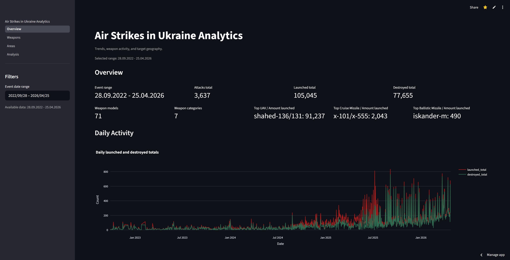
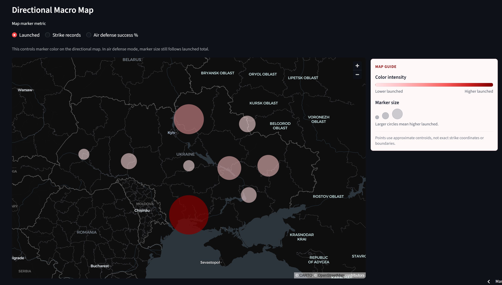
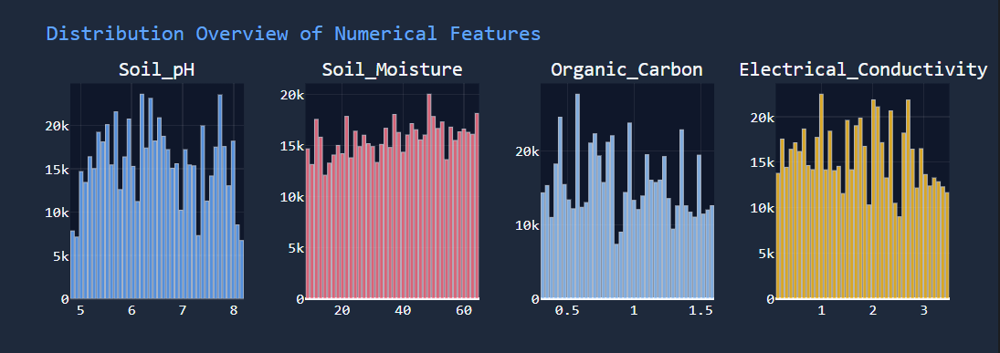
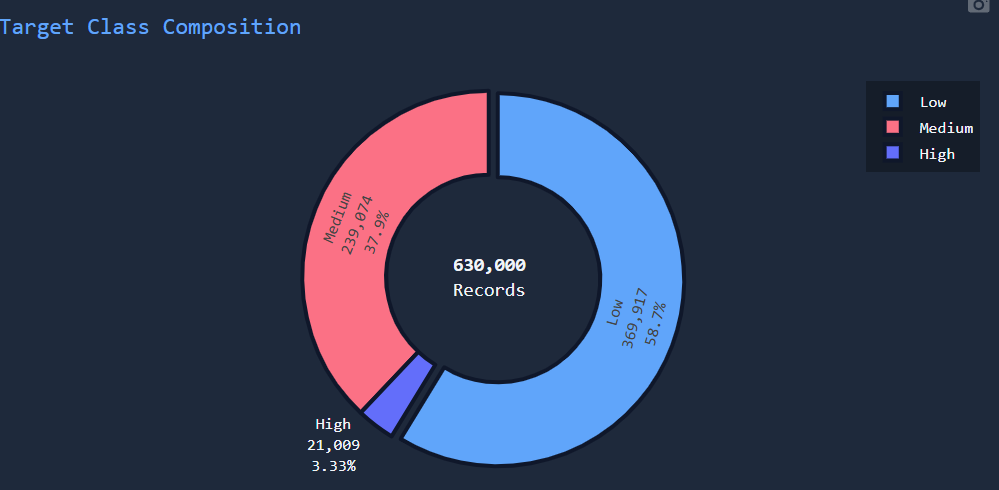
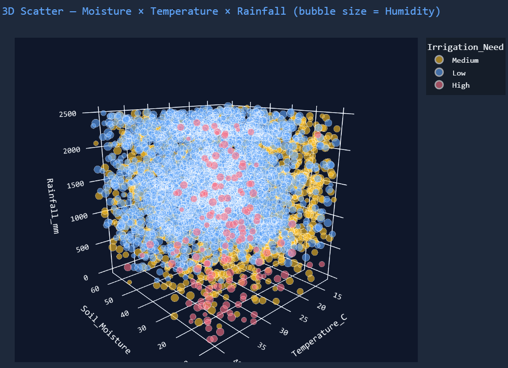

## Portfolio

A selection of my work in data engineering, analytics, and machine learning.

---

### Experience

### Cense Analytics - Machine Learning & Data Science Intern

Worked on building and maintaining data pipelines and machine learning solutions in a Databricks environment using Python, SQL, and Apache Spark. Focused on data quality and reliability by identifying inconsistencies, tracing root causes, and improving data structures for downstream use. Built image-based machine learning solutions end-to-end, including data preprocessing, feature engineering, model development, and validation, achieving strong results (details confidential).

---

### Projects & Data Science

#### Air Strikes on Ukraine Analysis Dashboard

In this MVP-stage project, I developed an end-to-end data analytics solution for exploring reported missile and UAV strike activity in Ukraine. The project combines data analysis, data engineering, and dashboard development: I collected and processed raw CSV data in Python with pandas, cleaned and standardized key fields such as dates, weapon references, and target areas, and transformed the data into a bronze, silver, and gold architecture. I then used DuckDB and SQL to build analytics-ready marts and views, and created an interactive Streamlit dashboard with Plotly and PyDeck to visualize trends over time, weapon activity, regional patterns, and air defense success rates.

  

    

      
    

    

      
    

  

  
Dashboard overview and interactive regional analysis.

  

    

      
    

    

      
    

  

  
Time period comparison and weapon share analysis.

#### Predicting Irrigation Need - Kaggle competition

In this notebook project, I built an end-to-end stacked machine learning workflow for the Kaggle Playground Series S6E4 irrigation need prediction task. The work combines exploratory data analysis, gradient boosting model development, and ensemble optimization: I profiled the raw tabular data in Python with pandas, compared feature distributions and class balance with interactive visual analysis, trained tuned XGBoost and CatBoost models, and generated out-of-fold probability predictions for model blending. I then optimized class-specific post-processing for the rare High irrigation class, trained a dedicated binary meta-model on top of the blended probabilities, and evaluated the full stack with cross-validation before exporting competition-ready submission files.

  

    

      
    

    

      
    

  

  
Exploratory views for feature distributions and target class composition.

  

    

      
    

    

      
    

  

  
Feature behavior and model interpretation views.

  
  
3D projection view for class separation analysis.

#### Korisliiga Winners App

This is a small web application for browsing Korisliiga championship winners. I included it as a lightweight side project alongside my main data and analytics work.

---
